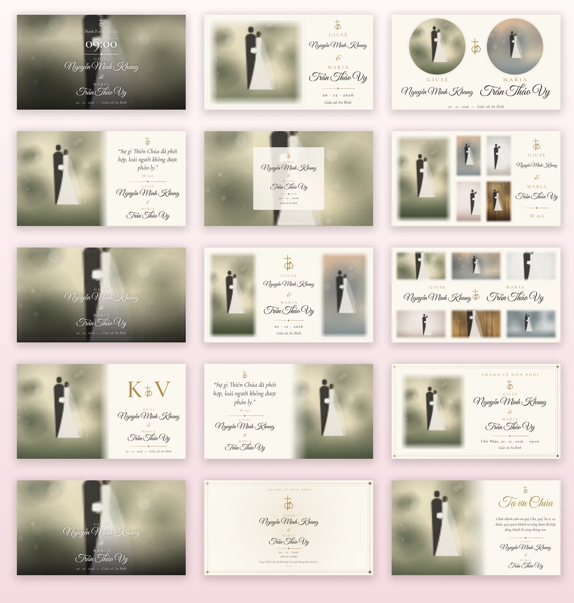
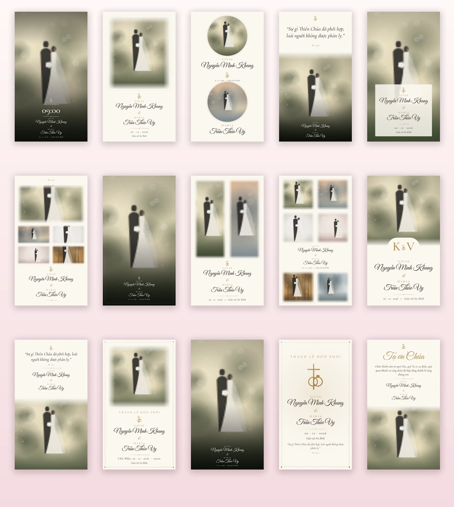
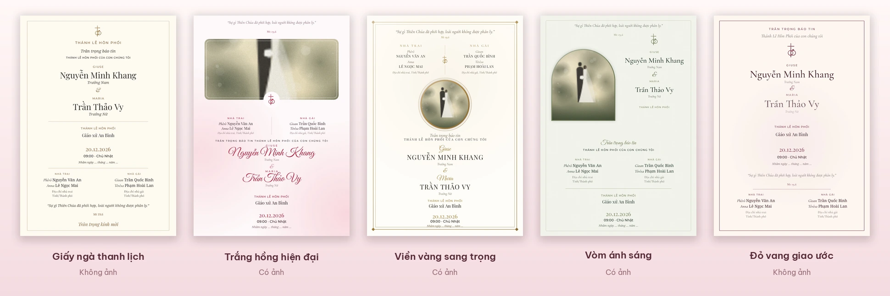
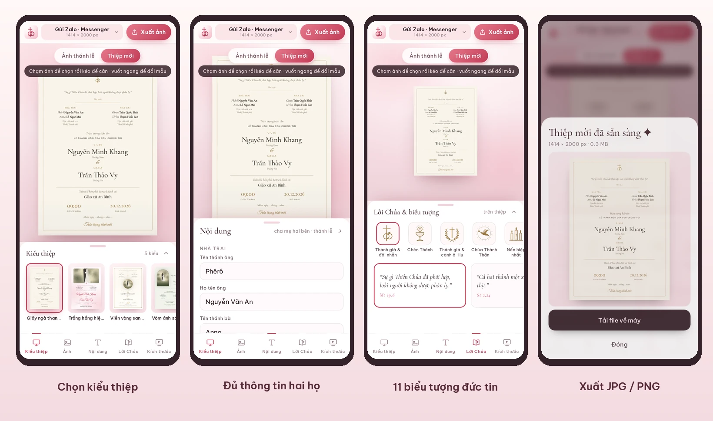

### [✦ Mở PaNIC Hôn Phối](https://panic-thanhle-hp.vercel.app)

Studio ảnh cưới chụp rất đẹp, nhưng thánh lễ hôn phối còn cần những điều riêng: 
**tên thánh**, **Lời Chúa**, **biểu tượng đức tin** — và một màn hình trang nghiêm trong nhà thờ. 
PaNIC Hôn Phối giúp gia đình và giáo xứ tự làm bộ ảnh ấy, cùng thiệp mời tham dự thánh lễ, chỉ trong vài phút.

 

## Ba bước là xong

 

## 15 mẫu ảnh cho thánh lễ — ảnh là chính

Mỗi mẫu luôn có **tên thánh** và **họ tên** của cả hai người — tên thánh chữ in hoa giãn cách, họ tên chữ viết tay — để cộng đoàn nhận ra ngay.

| Mẫu | Phù hợp |
|---|---|
| ⛪ **Chờ thánh lễ** | Chiếu trước giờ lễ — lời chào cộng đoàn, giờ bắt đầu thật lớn |
| 💍 **Chào mừng · Đôi ảnh tròn · Đôi ảnh dọc · Sáu khung** | Ảnh cưới chiếm phần lớn khung hình, tên thánh và họ tên gọn gàng |
| 📖 **Lời Chúa · Giao ước** | Câu Kinh Thánh nổi bật trên ảnh cưới hoặc làm tiêu đề lớn |
| ✝️ **Bí tích Hôn phối · Chữ lồng · Biểu tượng** | Trang nghiêm như thiệp, có ảnh hoặc chỉ biểu tượng |
| 🕊️ **Khung kính giữa ảnh · Kỷ niệm · Khung viền trắng · Ảnh lớn** | Ảnh toàn khung với thẻ chữ trong mờ, năm ảnh kỷ niệm |
| 🙏 **Cảm tạ** | *Tạ ơn Chúa* và lời cảm ơn quý Cha, ca đoàn, cộng đoàn khi kết lễ |

Tự sắp lại bố cục cho **tivi ngang 16:9 & 4K, tivi dọc 9:16, máy chiếu 4:3, bài đăng Facebook 4:5**, poster 60×90, A3 và standee 80×180.

 

## Thiệp mời tham dự thánh lễ

Nhập tên cha mẹ hai bên một lần — thiệp mời được dựng sẵn theo đúng lối thiệp Công giáo: **Nhà trai · Nhà gái**, *Trân trọng báo tin lễ thành hôn*, tên thánh và họ tên đôi tân hôn kèm thứ bậc (*Thứ Nam, Út Nữ…*), thánh đường, giờ lễ, **thứ trong tuần tự tính** và ngày âm lịch. Năm kiểu với bố cục, đường nét và font riêng:

- **Giấy ngà thanh lịch** — không dùng ảnh, chữ serif tinh tế, dấu ấn đức tin và hai khối thông tin gia đình cân đối
- **Trắng hồng hiện đại** — ảnh cưới lớn trên đầu, dải ngày tháng kẻ chỉ, chữ không chân kết hợp chữ bay
- **Viền vàng sang trọng** — ảnh tròn giữa thiệp, khối lịch ngày cỡ lớn, viền kép góc kim cương
- **Vòm ánh sáng** — ảnh cưới trong khung vòm, sắc xanh ô-liu, đôi tên đặt cạnh ảnh
- **Đỏ vang giao ước** — không dùng ảnh, đôi tên lớn, dải ngày lễ nổi bật trên nền ngà

Gửi qua Zalo, Messenger hoặc in khổ A5, A6. Tên, gia đình, địa chỉ và ngày lễ điền sẵn chỉ là dữ liệu minh hoạ hư cấu; hãy thay bằng nội dung của gia đình bạn trước khi gửi thiệp.

 

## Lời Chúa và biểu tượng đức tin

- **12 câu Kinh Thánh** thường dùng trong thánh lễ hôn phối, trích theo **bản dịch Công giáo của Nhóm Phiên dịch các Giờ Kinh Phụng vụ** — *Mt 19,6 · St 2,24 · St 1,27 · Ga 15,9 · Ga 15,12 · 1 Cr 13 · 1 Ga 4 · Cl 3,14* — hoặc tự nhập câu khác
- **11 biểu tượng** nét mảnh: **Thánh giá & đôi nhẫn**, Chén Thánh, Thánh giá & cành ô-liu, Chúa Thánh Thần, Nến hiệp nhất, Hai trái tim & Thánh giá, Lời Chúa, **Thánh đường**, **Chuỗi Mân Côi**, **Ba vòng hiệp nhất**, **Khiên đức tin**
- **9 bảng màu** trang nhã và 4 bộ font có dấu tiếng Việt chuẩn

 

## Làm trên điện thoại

| | |
|---|---|
| 📤 **Xuất ảnh** | Từng ảnh hoặc cả bộ — lưu vào Ảnh trên điện thoại, tải file ZIP để chép USB cắm tivi |
| 🖐️ **Chạm · kéo · zoom** | Chạm khung để chọn, kéo để căn ảnh, hai ngón để phóng to; vuốt ngang để đổi mẫu |
| ▶️ **Trình chiếu khi cần** | Chiếu cả bộ toàn màn hình, tự chuyển ảnh, màn hình không tự tắt |
| 🔒 **Riêng tư** | Không cần tài khoản; ảnh cưới được xử lý ngay trên máy, không tải lên đâu cả |

 

## Kiểm thử xuất thiệp

Cài Playwright trong môi trường phát triển bằng `npm install --no-save playwright` và `npx playwright install chromium`. Mở máy chủ tĩnh ở cổng 8000, rồi chạy `node tests/invitations.spec.cjs` trong terminal khác. Có thể đổi địa chỉ máy chủ qua `BASE_URL`.

Bài kiểm thử tải thật JPG/PNG của cả 5 mẫu ở khổ điện tử, A5 và A6; kiểm tra hộp tải ảnh, đầy đủ trường thông tin, các biểu tượng và việc giữ nội dung khách tự nhập.

 

**[✦ Bắt đầu tạo ảnh thánh lễ](https://panic-thanhle-hp.vercel.app)**

Một sản phẩm trong bộ sưu tập <b>PaNIC</b> · làm với ♥ cho các giáo xứ Việt Nam

